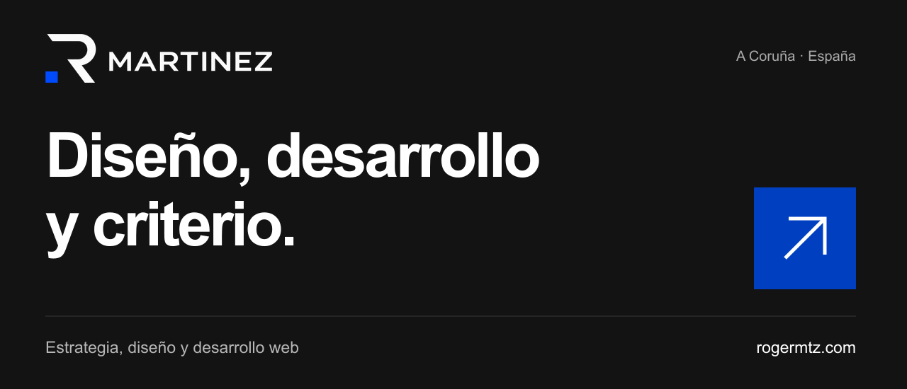

### Soy Roger, diseñador y desarrollador web.

Creo webs a medida para empresas y profesionales. Trabajo desde la estructura y la identidad visual hasta el desarrollo y la publicación, con especial atención a la experiencia móvil, la accesibilidad y el rendimiento.

Desde A Coruña, en remoto para toda España. También me estoy formando en **AI Engineering** y desarrollo proyectos de automatización e inteligencia artificial.

**[Portfolio ↗](https://rogermtz.com/)** &nbsp; · &nbsp; **[LinkedIn ↗](https://www.linkedin.com/in/rogermtz/)** &nbsp; · &nbsp; **[Hablemos ↗](mailto:contacto@rogermtz.com)**

---

### Cada web empieza por una decisión.

**[Villa Mia ↗](https://rogermtz.com/proyectos/villa-mia/)**  
Web de alojamiento turístico con reserva y pago online, sincronización con Airbnb y Booking y una app de gestión.

**[Parrillada Alcume ↗](https://rogermtz.com/proyectos/parrillada-alcume/)**  
La identidad del restaurante llevada a la web, con carta digital, menús de grupo y un sistema de reservas propio.

**[Ver todos los proyectos ↗](https://rogermtz.com/#proyectos)**

### También construyo con código e IA.

- **[SnackCheck](https://github.com/rogerdevmtz/snackcheck-nutrition-api)** — Workflow de n8n para evaluar productos mediante su código de barras.
- **[TrackFlow](https://github.com/rogerdevmtz/ai-engineering-trackflow)** — Proyecto de formación en AI Engineering centrado en automatización logística.
- **[DANZ](https://github.com/rogerdevmtz/rogerdevmtz-danz-artist-website)** — Landing para un DJ de A Coruña con HTML, CSS, accesibilidad y datos estructurados.

### Herramientas y tecnologías

**Web** &nbsp; HTML · CSS · JavaScript · TypeScript · Astro  
**Automatización e IA** &nbsp; Python · n8n · APIs  
**En cada proyecto** &nbsp; Identidad visual · Accesibilidad · SEO · Rendimiento

---

**¿Tienes un proyecto en mente?** [Cuéntame tu caso ↗](https://rogermtz.com/#contacto)
