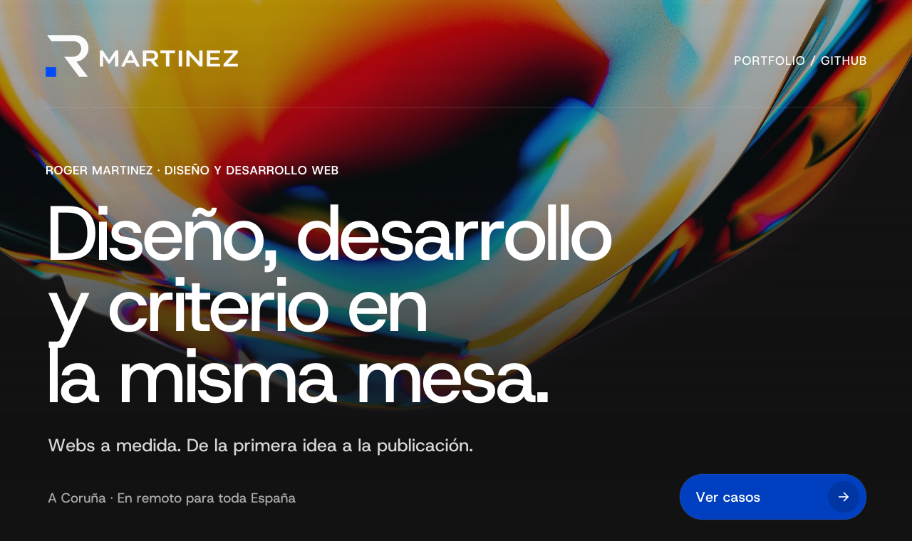
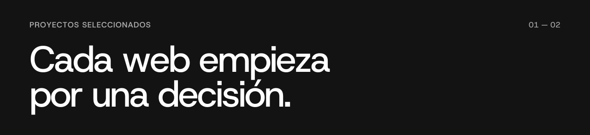
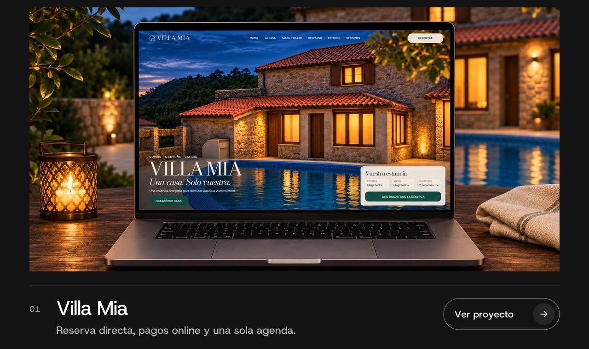
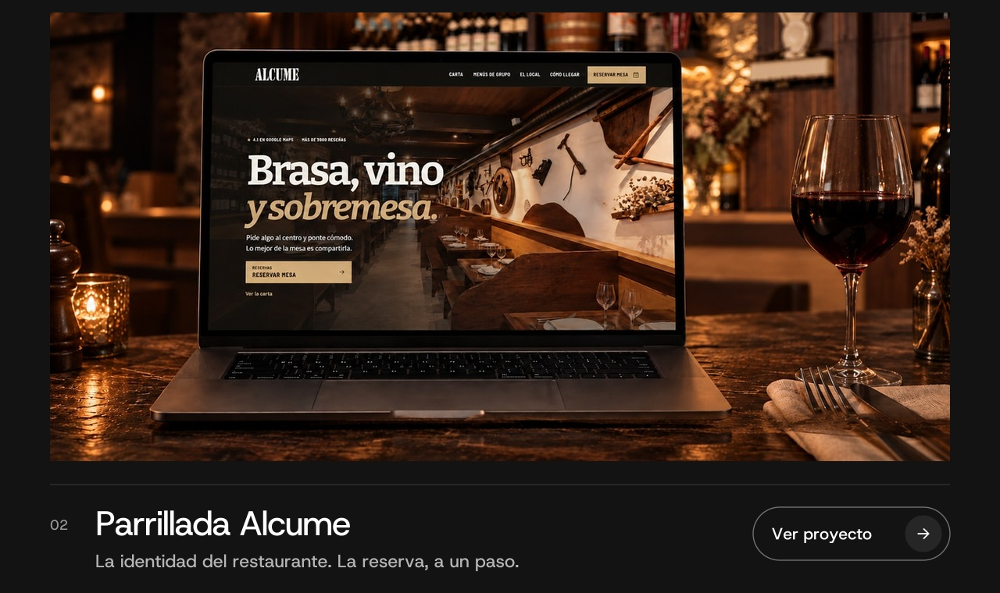
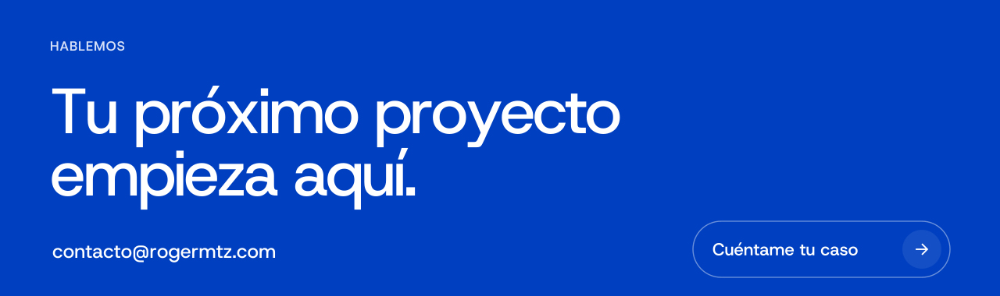

<a href="https://rogermtz.com/#proyectos"><picture><source media="(max-width: 600px)" srcset="./profile-cover-actions-mobile.png" /></picture></a>

Diseño y desarrollo webs para empresas y profesionales. Identidad visual, experiencia móvil, accesibilidad y rendimiento. Desde **A Coruña**, en remoto para toda España.

[Portfolio](https://rogermtz.com/) &nbsp; / &nbsp; [LinkedIn](https://www.linkedin.com/in/rogermtz/) &nbsp; / &nbsp; [Contacto](mailto:contacto@rogermtz.com)

<a href="https://rogermtz.com/#proyectos"><picture><source media="(max-width: 600px)" srcset="./work-intro-mobile.png" /></picture></a>

<a href="https://rogermtz.com/proyectos/villa-mia/"><picture><source media="(max-width: 600px)" srcset="./villa-mia-actions-mobile.jpg" /></picture></a>

<a href="https://rogermtz.com/proyectos/parrillada-alcume/"><picture><source media="(max-width: 600px)" srcset="./parrillada-alcume-actions-mobile.jpg" /></picture></a>

### Código, automatización e IA

Me estoy formando en **AI Engineering**. Aquí comparto proyectos de desarrollo y automatización:

| Proyecto | Qué construyo |
| :--- | :--- |
| [SnackCheck](https://github.com/rogerdevmtz/snackcheck-nutrition-api) | Workflow de n8n para evaluar productos por su código de barras. |
| [TrackFlow](https://github.com/rogerdevmtz/ai-engineering-trackflow) | Proyecto de formación sobre automatización logística. |
| [DANZ](https://github.com/rogerdevmtz/rogerdevmtz-danz-artist-website) | Landing para un DJ de A Coruña con accesibilidad y datos estructurados. |

**HTML · CSS · JavaScript · TypeScript · Astro · Python · n8n · APIs**

<a href="https://rogermtz.com/#contacto"><picture><source media="(max-width: 600px)" srcset="./contact-actions-mobile.png" /></picture></a>
