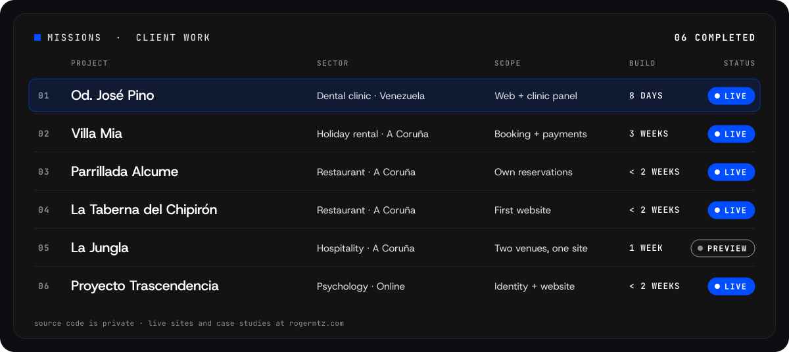
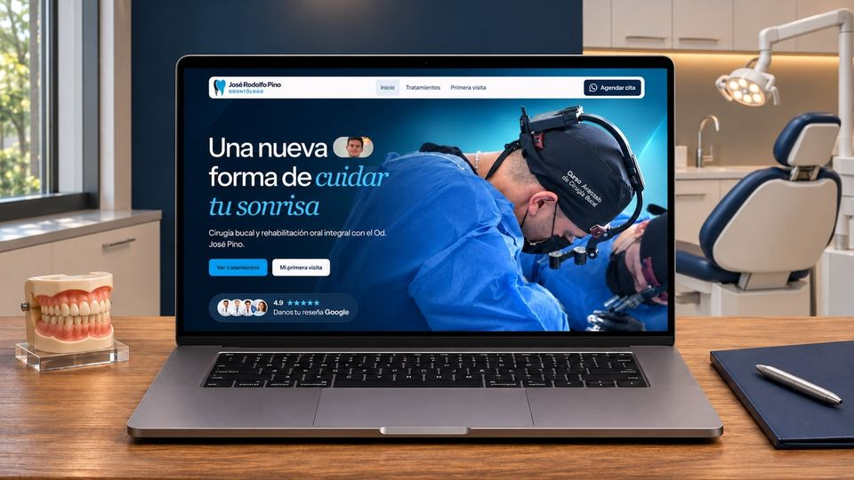
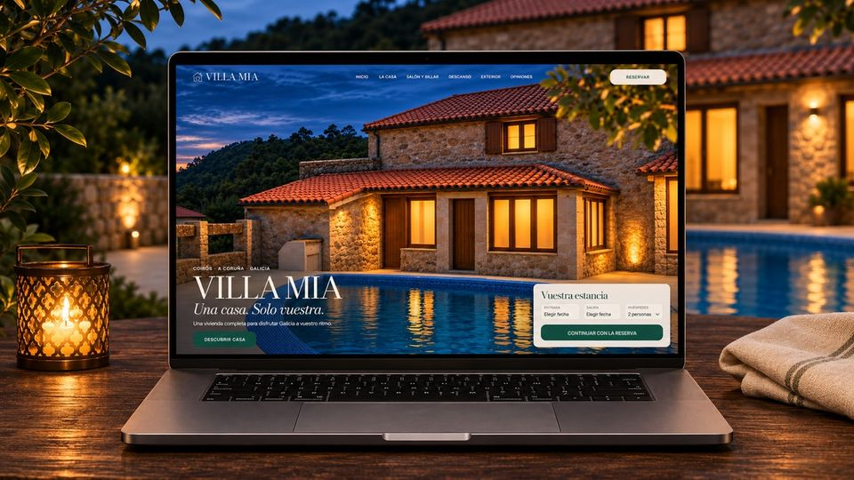
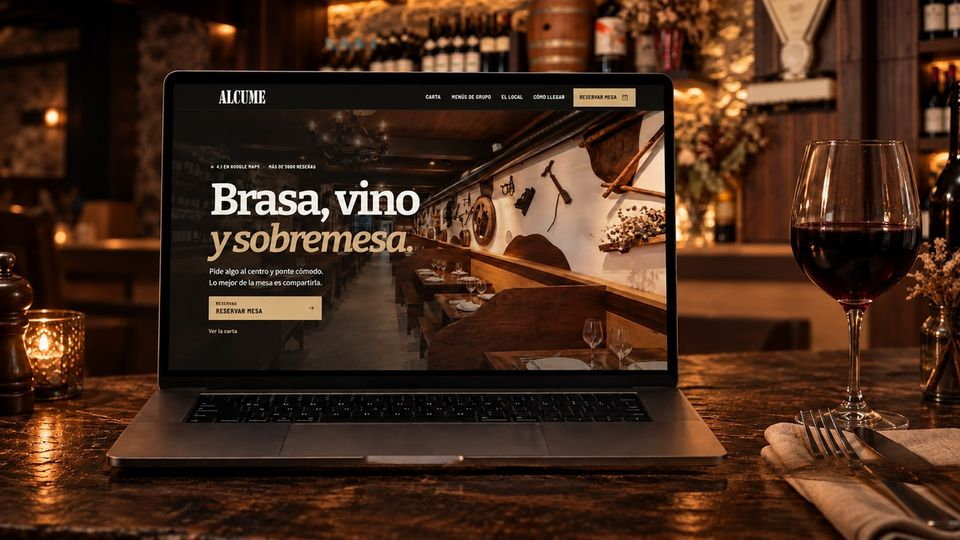
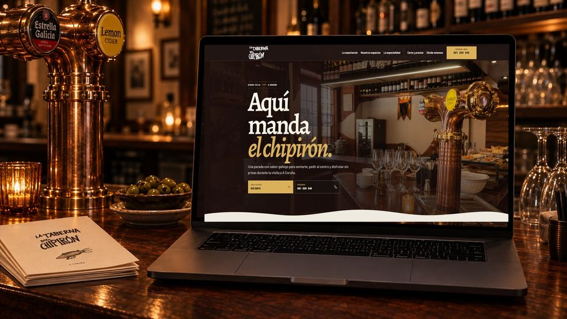
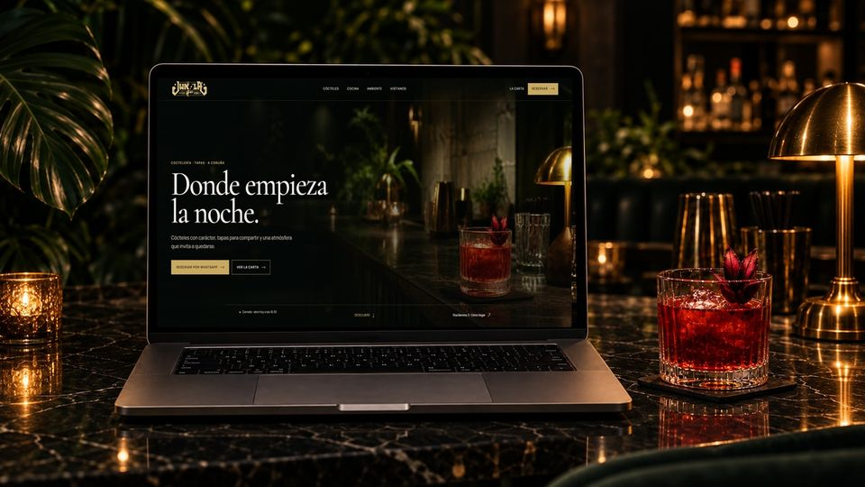
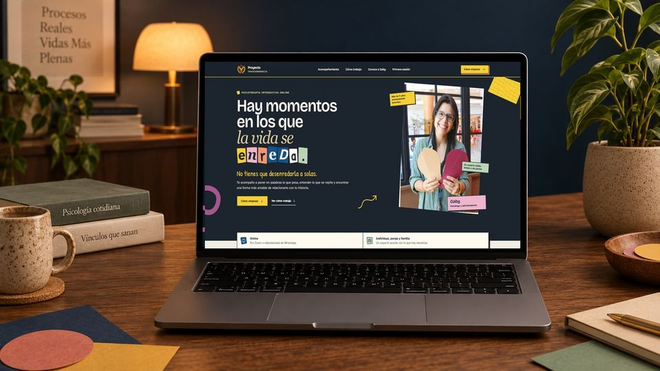
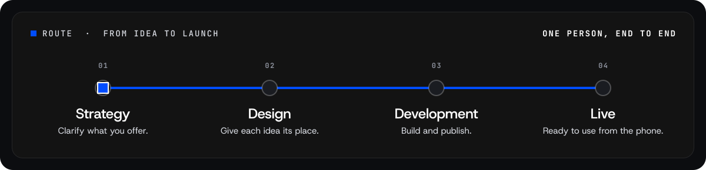

<!-- Roger Martinez · GitHub profile README · rogermtz.com -->

  &nbsp;
  &nbsp;
  &nbsp;
  

I design and build **custom websites for businesses and professionals**, and the tools behind them: direct booking, online payments and private management panels. Design and code at the same table, from the first call to launch. Remote across Spain, on site in A Coruña.

<table>
  <tr>
    <td width="33%" valign="top">
      
       <b>Od. José Pino</b> · <a href="https://rogermtz.com/proyectos/od-jose-pino/">Case study</a> · <a href="https://odjosepino.com/">Live</a>
    </td>
    <td width="33%" valign="top">
      
       <b>Villa Mia</b> · <a href="https://rogermtz.com/proyectos/villa-mia/">Case study</a> · <a href="https://villamiacoiros.com/">Live</a>
    </td>
    <td width="33%" valign="top">
      
       <b>Parrillada Alcume</b> · <a href="https://rogermtz.com/proyectos/parrillada-alcume/">Case study</a> · <a href="https://parrilladaalcume.com/">Live</a>
    </td>
  </tr>
  <tr>
    <td width="33%" valign="top">
      
       <b>La Taberna del Chipirón</b> · <a href="https://rogermtz.com/proyectos/taberna-del-chipiron/">Case study</a> · <a href="https://tabernadelchipiron.com/">Live</a>
    </td>
    <td width="33%" valign="top">
      
       <b>La Jungla</b> · <a href="https://rogermtz.com/proyectos/la-jungla/">Case study</a> · <a href="https://jungla.rogermtz.com/">Preview</a>
    </td>
    <td width="33%" valign="top">
      
       <b>Proyecto Trascendencia</b> · <a href="https://rogermtz.com/proyectos/proyecto-trascendencia/">Case study</a> · <a href="https://proyectotrascendencia.com/">Live</a>
    </td>
  </tr>
</table>

<b>Have a project in mind?</b>

  &nbsp;
  &nbsp;
  &nbsp;
  

 

  <a href="https://rogermtz.com/">
    <picture>
      <source media="(prefers-color-scheme: dark)" srcset="./assets/logo-dark.svg">
      <source media="(prefers-color-scheme: light)" srcset="./assets/logo-light.svg">
      
    </picture>
  </a>

